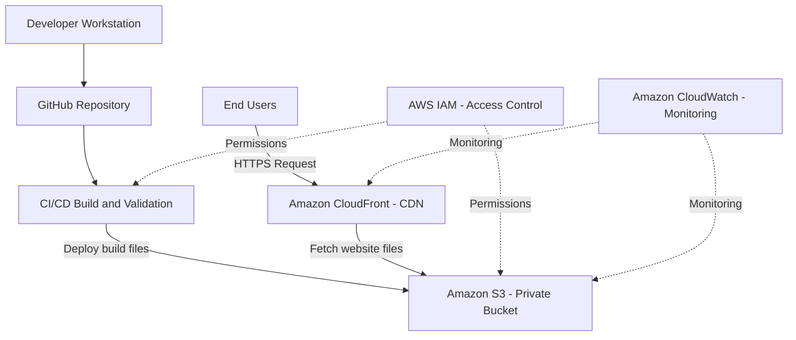

# GoSimplify360 – AWS Architecture Diagram

## 1. Architecture Overview

## 2. Component Explanation

### Developer Workstation
Develops and tests the React application locally.

### GitHub Repository
Stores application source code and version history.

### CI/CD Pipeline
Builds and validates the application before deployment.

### Amazon S3
Stores production build files in a private bucket.

### Amazon CloudFront
Delivers website content to users through a CDN.

### AWS IAM
Controls access to AWS services and resources.

### Amazon CloudWatch
Provides monitoring and operational visibility.

## 3. Security Design

- Keep the S3 bucket private.
- Use CloudFront Origin Access Control (OAC).
- Apply least-privilege IAM permissions.
- Use HTTPS for website traffic.
- Never store AWS credentials in source code.

## 4. Implementation Status

Architecture designed and documented locally.

No AWS infrastructure has been deployed.
